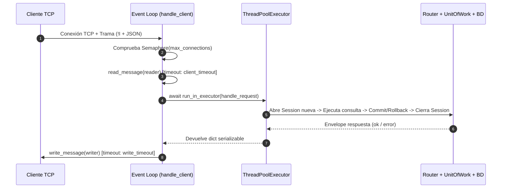

# Arquitectura Concurrente del Servidor TCP (`asyncio` + `ThreadPoolExecutor`)

## 1. Visión general y modelo híbrido

El servidor TCP (`server.py` / `src/server/app.py`) utiliza un modelo híbrido en dos niveles para atender múltiples clientes simultáneos sin reescribir la capa de dominio ni los repositorios ORM síncronos:

1. **Capa de red no bloqueante (`asyncio`):** Un único *event loop* gestiona el socket de escucha, la lectura/escritura de tramas TCP (`StreamReader` / `StreamWriter`), los *timeouts* por cliente y el control de admisión.
2. **Capa de persistencia aislada (`ThreadPoolExecutor`):** Cada petición válida se delega mediante `loop.run_in_executor(executor, handle_request, envelope, router)` a un *pool* dedicado de hilos (`db-worker-*`), evitando que las consultas a base de datos o la serialización de DTOs congelen al resto de clientes conectados.

```text
Clientes TCP (N conexiones simultáneas)
  ├── client.py (ServerGateway síncrono)
  └── AsyncServerGateway (asyncio)
         │
         ▼  [ Trama: 4B uint32 BE (!I) + JSON UTF-8 ]
┌─────────────────────────────────────────────────────────────────┐
│ Event Loop (asyncio - Hilo Principal)                           │
│  1. asyncio.start_server -> _on_connect()                       │
│  2. asyncio.Semaphore(max_connections)  [Control de admisión]   │
│  3. asyncio.wait_for(read_message, client_timeout)              │
│  4. loop.run_in_executor(executor, handle_request, ...)         │
│  5. asyncio.wait_for(write_message, write_timeout)              │
└───────────────────────────────┬─────────────────────────────────┘
                                │ (cola de tareas acotada)
                                ▼
┌─────────────────────────────────────────────────────────────────┐
│ ThreadPoolExecutor (max_workers = --workers)                    │
│  [db-worker-0]   [db-worker-1]   ...   [db-worker-W]            │
│       │               │                     │                   │
│       ▼               ▼                     ▼                   │
│  Router.handle -> Service -> UnitOfWork (1 Session por petición)│
└───────────────────────────────┬─────────────────────────────────┘
                                │
                                ▼
                   SQLAlchemy Engine (SQLite / PostgreSQL)
```

## 2. Ciclo de vida de una petición y apagado ordenado



### Protocolo de apagado ordenado (*Graceful Shutdown*)

Al recibir `SIGINT` o `SIGTERM` (o activarse `stop_event`):

1. `server.close()` deja de aceptar nuevas conexiones entrantes inmediatamente.
2. `_shutdown_active_tasks(active_tasks)` cancela las tareas de clientes activos (`task.cancel()`), espera su finalización (`asyncio.gather(..., return_exceptions=True)`) y cierra sus `StreamWriter` de forma limpia.
3. `await server.wait_closed()` confirma el cierre del descriptor de escucha (evitando el *deadlock* de Python 3.12+ al ejecutarse después de cancelar las tareas cliente).
4. `executor.shutdown(wait=True)` espera a que finalicen las transacciones en curso en los hilos trabajadores antes de invocar `engine.dispose()`.

## 3. Diseño *Sans-I/O* del protocolo (`src/common/protocol.py`)

La codificación y decodificación de tramas se ha separado de la E/S de red:

* **Núcleo puro (`encode_message`, `decode_header`, `decode_body`):** Opera exclusivamente sobre `bytes` y `dict`, validando el límite `MAX_MESSAGE_BYTES` (64 MiB) antes de reservar memoria para el cuerpo.
* **Adaptador síncrono (`send_message`, `receive_message`):** Utilizado por `ServerGateway` (`src/client/gateway.py`).
* **Adaptador asíncrono (`write_message`, `read_message`):** Utilizado por el servidor y por `AsyncServerGateway` (`src/client/async_gateway.py`), empleando `reader.readexactly(...)` para reensamblar tramas fragmentadas por TCP.

## 4. Controles de resiliencia y seguridad entre hilos

| Mecanismo | Parámetro CLI / Constante | Comportamiento ante fallo o saturación |
| :--- | :--- | :--- |
| **Control de admisión** | `--max-connections` (defecto: `100`) | Si el semáforo está lleno (`semaphore.locked()`), la conexión excedente se cierra de inmediato sin saturar memoria ni descriptores. |
| **Inactividad de lectura** | `--client-timeout` (defecto: `60.0` s) | Desconecta clientes ociosos cuando expira `asyncio.wait_for(read_message(...))`. |
| **Protección *slow-reader*** | `--write-timeout` (defecto: `10.0` s) | Cancela y cierra clientes que no vacían su ventana TCP al recibir respuestas. |
| **JSON o UTF-8 inválido** | `MalformedMessageError` | Responde `BAD_REQUEST` manteniendo alineado el flujo TCP para la siguiente trama. |
| **Trama sobredimensionada** | `MessageTooLargeError` (`> 64 MiB`) | Responde `BAD_REQUEST` y cierra el socket para evitar desincronización del flujo. |
| **Aislamiento transaccional** | `UnitOfWork` por petición | Cada llamada en `Router` instancia su propia `Session` de SQLAlchemy; nunca se comparten sesiones ni objetos ORM entre hilos. |

## 5. Comparativa: Modelo Híbrido vs. Async SQLAlchemy 2.0

En `src/domain/async_db.py` se incluye un corte vertical (*vertical slice*) con `create_async_engine`, `AsyncSession` (`expire_on_commit=False`) y `AsyncUnitOfWork` como referencia arquitectónica:

* **Modelo híbrido (`asyncio` + `ThreadPoolExecutor`):** Mantiene intactos los repositorios, `UnitOfWork`, servicios y `Router` de la Práctica 1. El paralelismo efectivo está acotado por $\min(N_{\text{clientes}}, W_{\text{workers}}, \text{conexiones\_BD})$.
* **Async SQLAlchemy 2.0 (`AsyncSession` + `asyncpg`/`aiosqlite`):** Elimina los hilos trabajadores y escala miles de conexiones en un solo hilo, pero requiere convertir toda la pila de llamadas a `async def` (*function coloring*) y sustituir la carga perezosa por `selectinload()` para evitar `MissingGreenlet`.